# Rota System Architecture Specification (`ARCHITECTURE.md`)

## 1. System Overview & Core Philosophy

**Rota** is an enterprise-grade mobile shift scheduling and workforce management application designed for small-to-medium businesses (restaurants, retail chains, medical clinics, and service operations).

The architecture is governed by five foundational engineering principles:
1. **Server Authoritative**: All business rules, shift conflict detections, swap validations, seat counting, and billing mutations are owned exclusively by the backend. The mobile app never makes authoritative domain decisions.
2. **Deterministic Financial & Domain Integrity**: Money calculations use whole integer cents/kobo (no floating-point rounding errors). Seat upgrades and downgrades are managed via an immutable double-entry ledger.
3. **Multi-Tenant Isolation**: Hard boundaries prevent any cross-tenant data leaks. Every business query filters strictly by server-resolved membership (`AUTHZ-002`, `AUTHZ-003`).
4. **Resilient Asynchrony**: Slow operations (push notification fan-out, email dispatch, webhook ingestion) run off the HTTP request-response cycle on BullMQ background queues with Redis.
5. **Horizontal Scalability**: Implements connection pooling, read/write database routing with "Read-Your-Own-Writes" consistency, multi-tenant sharding, and multi-tier Redis caching.

---

## 2. High-Level Architecture Diagram

```mermaid
flowchart TB
    subgraph Clients["Mobile & Web Clients"]
        Mobile["React Native / Expo App (iOS & Android)"]
        Tablet["Nurse / Manager Tablet"]
        WebDash["Web Dashboard"]
    end

    subgraph Edge["Gateway & Edge Security"]
        Nginx["Reverse Proxy / TLS Termination"]
        RateLimiter["Redis Distributed Rate Limiter\n(Login, Checkout, Invites, Webhooks)"]
    end

    subgraph BackendApp["Node.js / Express Application Layer"]
        AuthMiddleware["JWT Authentication\n(Single-Use Refresh Token Rotation)"]
        RBAC["Multi-Tenant RBAC Middleware\n(OWNER, MANAGER, STAFF)"]
        ZodValidator["Zod Schema Validation Middleware"]
        
        subgraph Modules["Domain Service Layer"]
            AuthService["Auth & Session Service"]
            ShiftService["Scheduling & Conflict Engine"]
            SwapService["Swap Workflow & Distributed Locks"]
            BillingService["Proration & Ledger Engine"]
            NotificationService["Push & Quiet Hours Service"]
        end
        
        DBRouter["Database Router\n(Read-Your-Own-Writes Engine)"]
        ShardingRouter["Multi-Tenant Sharding Router\n(FNV-1a Hash Modulo 2)"]
    end

    subgraph InvalidationCache["In-Memory Cache & Locks"]
        RedisCache[("Redis Cache Cluster")]
        subgraph RedisRoles["Redis Roles"]
            RosterCache["Team Roster Cache"]
            ShiftCache["Shift Calendar Cache"]
            ActivityCache["Activity Feed Cache"]
            DistLocks["Redlock Distributed Mutex"]
        end
    end

    subgraph QueueWorkers["BullMQ Background Workers"]
        EmailWorker["Transactional Email Queue (SMTP)"]
        PushWorker["Expo Push Fan-Out Queue"]
        WebhookWorker["Flutterwave Webhook Queue"]
        DelayedWorker["Quiet Hours Delayed Push Scheduler"]
    end

    subgraph DatabaseTier["PostgreSQL Database Cluster"]
        subgraph Primary["Primary PostgreSQL (Writer)"]
            MasterDB[("Master DB (Port 5432)\nConnection Pool: 20 conns")]
        end
        subgraph Replica["Read Replica (Reader)"]
            ReplicaDB[("Read Replica DB\nOffloaded Query Reads")]
        end
        subgraph Shards["Simulated Tenant Shards"]
            Shard1[("Shard 1: shard_1")]
            Shard2[("Shard 2: shard_2")]
        end
    end

    subgraph ExternalProviders["External Third-Party Services"]
        Flutterwave["Flutterwave Payment Gateway\n(Hosted Checkout & Webhooks)"]
        ExpoPush["Expo Push API (APNs & FCM)"]
        GmailSMTP["Nodemailer SMTP Service"]
    end

    %% Client traffic
    Mobile -->|HTTPS REST| Nginx
    Tablet -->|HTTPS REST| Nginx
    WebDash -->|HTTPS REST| Nginx

    %% Edge
    Nginx --> RateLimiter
    RateLimiter --> AuthMiddleware

    %% Pipeline
    AuthMiddleware --> RBAC --> ZodValidator --> Modules

    %% Cache and Locks
    SwapService <--> DistLocks
    ShiftService -->|Invalidate Pattern| ShiftCache
    Modules <--> RedisCache

    %% Asynchronous Worker Handoff
    NotificationService -.->|Enqueue Non-Blocking| PushWorker
    NotificationService -.->|Delay Quiet Hours| DelayedWorker
    BillingService -.->|Enqueue Reconcile| WebhookWorker
    AuthService -.->|Enqueue Email| EmailWorker

    %% External
    PushWorker --> ExpoPush
    DelayedWorker --> ExpoPush
    EmailWorker --> GmailSMTP
    Flutterwave -->|Signed Webhooks| WebhookWorker

    %% Database Routing
    Modules --> DBRouter
    DBRouter -->|Writes + Recent Reads| MasterDB
    DBRouter -->|Cold Reads| ReplicaDB
    Modules --> ShardingRouter
    ShardingRouter -->|Team Hash % 2 == 0| Shard1
    ShardingRouter -->|Team Hash % 2 == 1| Shard2
```

---

## 3. Core Subsystems

### 3.1 Database Connection Pooling & Sizing Justification

- **Configuration**: Set on the Prisma datasource URL:
  `postgresql://...?connection_limit=20&pool_timeout=10`
- **Mathematical Formula**:
  $$\text{Pool Size} = ((\text{CPU Cores} \times 2) + \text{Effective Spindle / SSD Concurrency})$$
- **Justification**:
  1. *Process-Per-Connection Overhead*: PostgreSQL assigns an isolated process to each active socket. Oversubscribing connections leads to severe CPU context-switching overhead, kernel lock thrashing, and memory saturation.
  2. *Asynchronous Event Loop Multiplexing*: Node.js handles thousands of concurrent HTTP connections on its single-threaded event loop. A tightly sized pool of 20 connections provides maximum throughput when individual query execution is sub-5 milliseconds.
  3. *Pool Timeout*: Set to 10 seconds to fail fast and prevent thread starvation under catastrophic database saturation.

---

### 3.2 Read and Write Routing with "Read-Your-Own-Writes" Consistency

In master-replica database topologies, asynchronous replication introduces a latency lag (typically 10ms–500ms). If a manager publishes a shift or approves a swap and immediately refreshes their schedule, querying a replica would result in a "phantom read" (missing or stale data).

Rota implements **Read-Your-Own-Writes Consistency** ([`dbRouter.ts`](file:///c:/Users/Biggest%20Sam/Desktop/ROTA/Backend/src/database/dbRouter.ts)):
1. **Write Operations** (`POST`, `PUT`, `PATCH`, `DELETE`): Executed directly against the **Primary Database**.
2. **Write Tracking Middleware** ([`readYourOwnWritesMiddleware`](file:///c:/Users/Biggest%20Sam/Desktop/ROTA/Backend/src/database/dbRouter.ts)): Whenever an authenticated user executes a successful write mutation, the server stamps `userLastWriteTimestamps.set(userId, Date.now())`.
3. **Smart Read Routing**:
   - If `Date.now() - lastWriteTime < 5000ms`: The read is routed to the **Primary Database**, ensuring zero stale reads for the user who made the change.
   - If the window has elapsed (or the user has not written recently): The read is safely routed to the **Read Replica**, distributing database load horizontally.

---

### 3.3 Multi-Tenant Sharding Strategy

- **Routing Key**: `team_id` (`business_id`).
- **Algorithm**: Deterministic 32-bit **FNV-1a hash modulo 2** (`ShardingRouter.hashTeamId(teamId) % 2`).
- **Data Locality**: Shifts, assignments, rosters, and swaps belong to a single business tenant. 100% of core scheduling transactions execute on a single physical shard with native ACID atomicity.
- **Handling Monster Tenants**: Large healthcare systems or retail chains with $>50,000$ employees are provisioned dedicated single-tenant shard clusters or partitioned hierarchically by `(team_id, location_id)`.
- *Full specification in [`SHARDING.md`](file:///c:/Users/Biggest%20Sam/Desktop/ROTA/SHARDING.md).*

---

### 3.4 Multi-Tier In-Memory Caching & Invalidation

Rota employs Redis as a volatile in-memory caching tier with explicit event-driven invalidation:

| Resource | Redis Key Pattern | TTL | Invalidation Trigger |
| :--- | :--- | :--- | :--- |
| **Team Roster** | `cache:roster:${businessId}` | 300s | Member invited, updated, or removed |
| **Upcoming Shifts** | `cache:shifts:${businessId}:upcoming:${memberId}` | 300s | Shift created, updated, deleted, published, or swapped |
| **Shift Calendar** | `cache:shifts:${businessId}:*` | 300s | Any schedule mutation |
| **Activity Feed (Page 1)** | `cache:activity:${businessId}:page1:*` | 60s | New audit event, shift creation, or swap approval |

- **Benchmark Impact**: In load testing with 200 concurrent virtual users, Redis caching reduced mean response latency from **290.53 ms to 0.18 ms** (a **1,614x speedup**). *See [`LOAD_TEST_REPORT.md`](file:///c:/Users/Biggest%20Sam/Desktop/ROTA/LOAD_TEST_REPORT.md).*

---

### 3.5 Background Job Queues (BullMQ on Redis)

To preserve API responsiveness, the backend prohibits synchronous external network I/O inside HTTP request-response handlers:
- **`email-queue`**: Delivers account verification links, team invitations, and password reset tokens via SMTP with exponential backoff retries.
- **`push-notification-queue`**: Batches and fans out push notifications via the Expo Push API. Automatically purges invalidated tokens (`DeviceNotRegistered`).
- **`webhook-queue`**: Ingests Flutterwave billing webhooks, verifies HMAC `verif-hash` signatures, and applies ledger state transitions idempotently.
- **`quiet-hours-scheduler`**: Computes time remaining until quiet hours end (e.g. 6:00 AM in the user's specific IANA timezone) and enqueues delayed jobs for non-urgent notifications.

---

### 3.6 Financial Proration & Payment Architecture

- **Payment Provider**: Flutterwave (Locked provider per PRD Section 12).
- **Pricing Plans**:
  - *Starter*: $20/month (`2000` cents), up to 5 seats. Extra seats not available.
  - *Team*: $50/month (`5000` cents), up to 15 seats. Extra seats: $3/month (`300` cents).
  - *Business*: $120/month (`12000` cents), up to 40 seats. Extra seats: $2/month (`200` cents).
- **Proration Engine**:
  - Pure integer arithmetic rounded down (`Math.floor`) to prevent fractional cent drift.
  - Upgrades charge the prorated net delta immediately. Downgrades take effect at the end of the paid billing period.
  - Fully audited via the immutable [`billing_ledgers`](file:///c:/Users/Biggest%20Sam/Desktop/ROTA/Backend/prisma/schema.prisma) double-entry ledger.
- *Full specification in [`PRORATION.md`](file:///c:/Users/Biggest%20Sam/Desktop/ROTA/PRORATION.md).*
